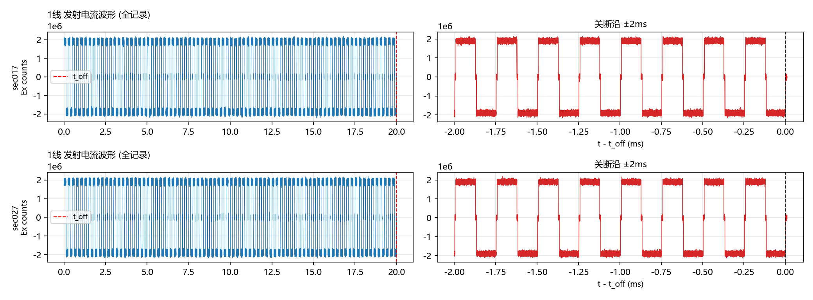
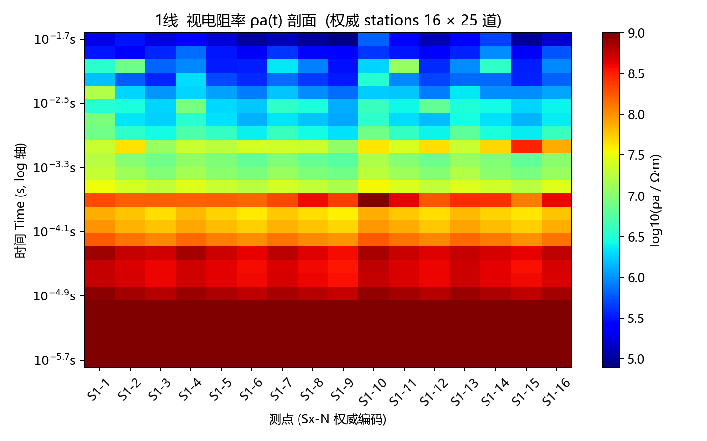
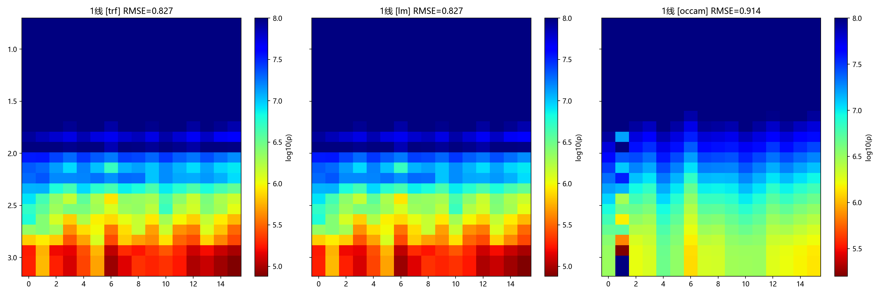
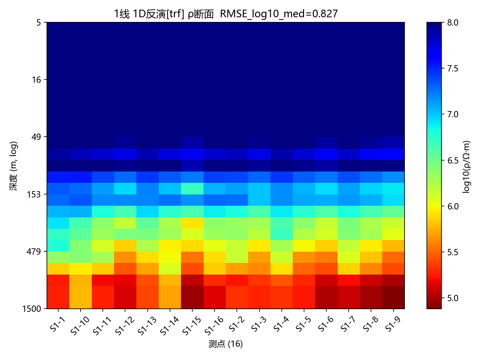

# TFM-TEM-Inversion

  

An all-in-one Time-Frequency Electromagnetic (TFM / TEM & IP) processing suite — a **pure Python**
implementation benchmarked against the commercial WLF software. It covers the full workflow from
raw WLF binary acquisition files (DAT) → preprocessing → apparent resistivity → 1D resistivity
inversion (multiple algorithms) → IP chargeability inversion → Occam1D / WLF EXE bridging.

> **Offline statement**: This software runs 100% offline. All data is read from and written to
> local disk only — nothing is ever uploaded to any cloud or remote server.

---

## Features

| Module | Capability |
|---|---|
| Tx current processing | Waveform analysis of uppercase calibration files CXXST01: plateau amplitude, turn-off time t_off, bipolar ripple, inter-picket consistency QC |
| Preprocessing | Inventory → DAT loading → cube alignment (authoritative station codes) → ADC conversion → DC removal → 25 time gates → ρa (central-loop formula) → QC → Occam.dat |
| Enhanced preprocessing | AATZero turn-off refinement, notch, band-pass, MAD outlier rejection, decay-curve extraction (preprocess_plus) |
| Layered-model forward | 1D TEM forward: Guptasarma 61-point Hankel transform + Anderson frequency→time conversion, with Cole-Cole IP support |
| 1D inversion (multi-algo) | TRF (trust-region, default) / LM (Levenberg-Marquardt) / pure-Python Occam (smooth inversion), with three-algorithm comparison |
| IP chargeability inversion | Pelton Cole-Cole 4-parameter model (ρ, m, τ, c), robust shared-τ/c mode |
| Signal visualization | WLF curview/verify style: 4×4 decay-curve subplots, multi-station Hx overlay |
| Bridging | Occam1D cfg/model-p/BAT generation (with dry-run); WLF TRANS24 format conversion, SWP24D 2D inversion, 3D tomo pipeline |

## Repository Layout

```
TFM-TEM-Inversion/
  README.md            # Chinese documentation (中文文档)
  README_EN.md         # This file
  requirements.txt     # Dependencies
  LICENSE              # MIT
  run_tfm.bat          # Windows one-click launcher (GUI default / --cli headless)
  tfm_gui.py           # GUI entry (7 tabs)
  tfm_cli_run.py       # Headless CLI entry (full pipeline)
  make_demo_data.py    # Synthetic demo-data generator
  tfm_engine/          # Processing engine package (13 modules)
    dat_parser.py        excel_meta.py    coord_loader.py
    preprocess.py        preprocess_plus.py
    inversion.py         inv_algorithms.py  ip_inversion.py
    forward.py           occam_bridge.py    signal_viz.py
    wlf_bridge.py        current_proc.py
```

## Installation

- Python ≥ 3.10
- `pip install -r requirements.txt` (numpy / scipy / pandas / matplotlib / openpyxl)

## Quick Start

### 1. Generate demo data

```bat
python make_demo_data.py
```

Creates `demo_data/myfile_demo/` (1 line × 2 sections, 16 stations S1-1..S1-16,
8 DAT files of ~26 MB each + two Excel metadata files). Idempotent — safe to re-run.

### 2. Run the full pipeline (headless CLI)

```bat
python tfm_cli_run.py --project demo_data\myfile_demo --out demo_out --current --inv-algo trf --no-occam
```

or `run_tfm.bat --cli --project demo_data\myfile_demo --out demo_out --current --no-occam`

### 3. GUI

Double-click `run_tfm.bat` or run `python tfm_gui.py`. Seven tabs:

1. **Basic Pipeline** — preprocessing + 1D inversion main pipeline
2. **Layer Model** — layered-model designer (N layers × 5 parameters)
3. **Forward Compare** — model forward vs observed curve overlay
4. **Signal Viewer** — 4×4 decay curves / multi-station Hx inspection
5. **IP Inversion** — line-wide / single-station chargeability inversion
6. **WLF 2D/3D** — TRANS24 / SWP24D / 3D tomo bridging
7. **Tx Current** — transmitter-current waveform & QC

## Example Results

The results below were produced end-to-end by `tfm_cli_run.py --current --inv-algo all`
on the synthetic dataset from `make_demo_data.py` (1 line × 2 sections, 16 stations S1-1..S1-16).
Preprocessing passed QC on 16/16 stations (400 ρa gates); transmitter-current QC is nominal
(Ex bipolar square-wave plateau 1.90e6 counts ≈ 0.45 V, t_off = 19.99 ms).

| 1D inversion algorithm | Stations | Median RMSE_log10 |
|---|---|---|
| TRF (trust-region, default) | 16 | 0.827 |
| LM (Levenberg-Marquardt) | 16 | 0.827 |
| Occam (pure-Python smooth) | 16 | 0.914 |

Interpretation: all three algorithms agree on the same dataset (RMSE_log10 < 1.0 is the expected
range for the skeleton diffusion-depth forward approximation); TRF/LM fit slightly better and are
more robust with bound constraints, while the smooth Occam model serves as cross-validation.
To reduce overall RMSE, follow the tuning discipline: adjust `RHOA_SCALE_CAL` first
(global ρa calibration), then `LAMBDA_SMOOTH` / `LAMBDA_INIT`.

| Tx current waveform QC | Apparent-resistivity ρa section |
|---|---|
|  |  |

| Three-algorithm section comparison | TRF inverted resistivity section |
|---|---|
|  |  |

## Data Format

### DAT binary contract (strictly validated by tfm_engine/dat_parser.py)

- File size = `2048 + 4 × 544859 × Np × 4` bytes (Header + int32 LE data; Np in 1..10)
- Header is 2048 bytes; first 64 bytes = 32 int16 LE values:
  `Int16[11..14]=8224`, `Int16[15]=1024`, `Int16[26]=0x0102`, `Int16[29]=1`, `Int16[27]=256+Np`;
  `Int16[4:15]` holds an ASCII signature (uppercase current files contain "Xi'An,China",
  lowercase receiver files contain "area"; one character per int16 low byte)
- Data block: int32 LE, `reshape(4, 544859, Np, order='C')`, channels 0=Ex 1=Ey 2=Hx 3=Hy
- Naming: uppercase `CXXST01.DAT` (transmitter-current calibration);
  lowercase `cXXXst00Y.dat` (receiver, Y=001/002/003)

### Excel four-sheet contract (`X线/发射接收备注信息.xlsx` per survey line)

1. **Receiver-to-station map**: columns = [date, array, station, channel, instrument, remark];
   forward-fill semantics (date/array/station/instrument appear only on the first row of a block)
2. **Tx–Rx correspondence**: 2 header rows; data rows: col 2 = Tx file name, cols 4..6 = receiver
   file names of the three instruments (row order = authoritative section order)
3. **Tx schedule**: columns = [file name, date, start time, end time, current]; the current
   (e.g. "30A") is the authoritative I_tx
4. **Coordinates**: 2 multi-level header rows; cols 0..3 = [instrument, line, station, mag-bar],
   may include transmitter-loop corner coordinates

### Coordinate file contract (`坐标文件.xls` at project root)

- **MN coordinates** (no header): station_code, X, Y, Z (e.g. S1-1..S1-16)
- **Source coordinates** (no header): four loop corners A1/B1/A2/B2; odd lines use area A1B1,
  even lines use area A2B2

## Algorithms

- **Forward**: Boerner-style diffusion-depth approximation δ(t)=√(2ρ_ref·t/μ₀)/2 mapping layered
  log₁₀ρ onto ρa(t); forward.py additionally provides a rigorous Guptasarma 61-point Hankel +
  Anderson frequency→time forward (with Cole-Cole IP response)
- **TRF**: scipy least_squares (trust-region with bounds [0.1, 1e8] Ω·m); residual = weighted
  log-data residual + √λ·inter-layer smoothness
- **LM**: classic Levenberg-Marquardt damped least squares (unbounded, soft-clipped)
- **Occam (pure Python)**: Constable 1987 smooth inversion — outer-loop linearization with
  λ search driving χ²/N → 1
- **IP inversion**: Pelton Cole-Cole 4-parameter model (ρ, m, τ, c), with a robust mode sharing
  τ/c across the whole line

## Tuning Discipline (one variable at a time, few steps)

1. **RHOA_SCALE_CAL** (preprocessing, default 1e6): global ρa calibration multiplier — the first
   knob to turn (`--rhoa-scale`)
2. **LAMBDA_SMOOTH** (1D inversion, default 0.3): inter-layer smoothness weight (`--lambda-smooth`)
3. **LAMBDA_INIT** (Occam, default 1.0): initial regularization factor, sweep 0.1→1→10
   (`--lambda-init`)

Change only one parameter per run; inspect RMSE and section morphology before the next step.

## Output Files (out_dir/<line>/)

| File | Content |
|---|---|
| `<line>_occam.dat` | OCCAMITER_FLEX / EMData_1.1 9-column data (X Y Z Time AppRes StdDev Station Section Instruments) |
| `<line>_rhoa_section.png` | Apparent-resistivity ρa(t) section image |
| `<line>_pickup_xyz.csv` | Station metadata table (coordinates, QC flags, median ρa, etc., utf-8-sig) |
| `<line>_inv_{algo}_R.npy` / `_depth.npy` | Inverted true-resistivity tensor [station, layer] and layer-center depths |
| `<line>_inv_{algo}_summary.csv` | Per-station RMSE / nfev / ρ range |
| `<line>_inv_{algo}_section.png` | 1D inverted true-resistivity section |
| `<line>_current_summary.csv` / `_waveforms.png` | Tx-current QC summary and waveform plots |
| `cli_run_*.log` / `cli_summary_*.json` / `preprocess_report_*.json` | Run logs and parameter snapshots |

## License

This project is released under the [MIT License](LICENSE).
Copyright (c) 2026 TFM-TEM-Inversion contributors.

---

中文文档 → [README.md](README.md)
